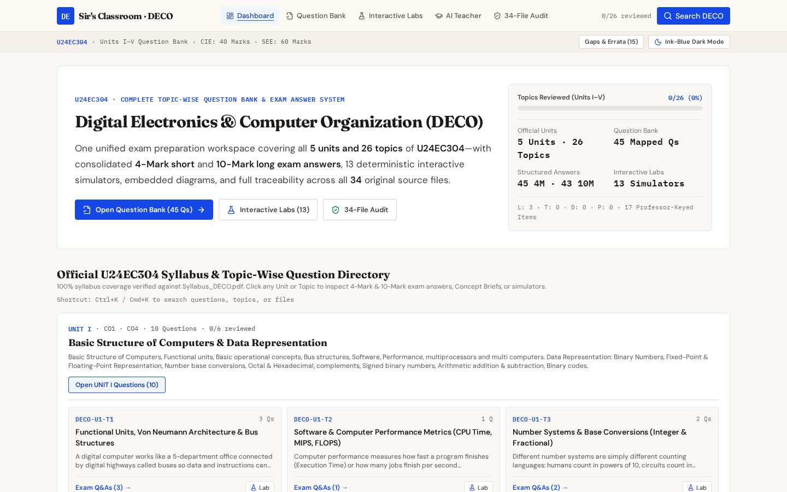
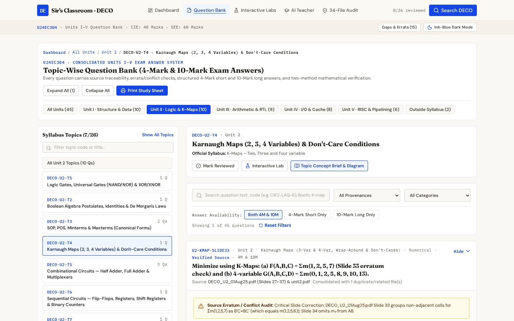
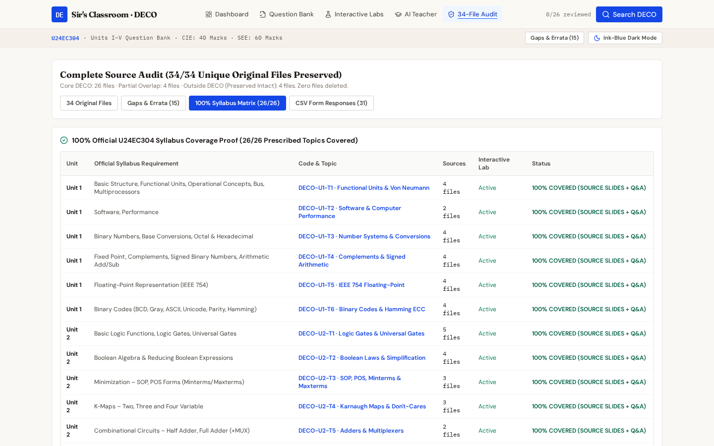

# DECONOVA — Digital Electronics & Computer Organization (`U24EC304`)

**Topic-Wise Question Bank, Structured Exam Answer System, 34-File Provenance Audit & 13 Interactive Laboratories**

[](#installation-and-usage)
[](#verification-and-testing)
[](#tech-stack)
[](#curriculum-coverage)
[](#curriculum-coverage)
[](#tech-stack)
[](#tech-stack)
[](#tech-stack)

---

## Project Summary

**DECONOVA** (*Sir's Classroom · DECO*) is a full-stack educational web application engineered for undergraduate **Digital Electronics & Computer Organization (`U24EC304`, CIE 40 + SEE 60 Marks)**. It consolidates **34 original academic source artifacts**—including the official syllabus PDF, lecture slide decks, assignments, surprise tests, quizzes, question papers, student response CSV data, and reference logic diagrams—into a single deterministic, source-traceable exam preparation and simulation platform.

Rather than leaving definitions, numerical derivations, and conflicting answer keys scattered across unindexed PDFs, DECONOVA maps every curriculum objective into a structured academic knowledge graph with dual-method arithmetic verification and inline errata auditing:

| Platform Dimension | Verified Metric | Engineering & Academic Scope |
| :--- | :---: | :--- |
| **Curriculum Alignment** | **5 Units · 26 Topics** | `100%` coverage against `Syllabus_DECO.pdf` (`CO1–CO5`) |
| **Consolidated Question Bank** | **45 Questions** | Units I–V (`43` in-syllabus) + `2` Outside-Syllabus audit items |
| **Exam Answer Structuring** | **45 4-Mark · 43 10-Mark** | Short (`4M`) & long (`10M`) exam responses (`17` professor-keyed) |
| **Interactive Laboratories** | **13 Simulators** | Deterministic calculators & step-by-step register/pipeline traces |
| **Source File Preservation** | **34 / 34 Original Files** | Core DECO (`26`), Partial Overlap (`4`), Outside Scope (`4`) |
| **Audit Registers** | **9 Errata · 6 Gaps** | Slide/answer-key conflicts & syllabus gaps flagged inline |

---

## Key Feature Highlights

### 1. Topic-Wise Question Bank (4-Mark & 10-Mark Exam Answers)
- Filter questions by **Unit (`I–V` or `Outside Syllabus`)**, **Syllabus Topic (`DECO-U1-T1` – `DECO-U5-T4`)**, **Provenance**, **Category**, or **Answer Availability** (`Both 4M & 10M`, `4-Mark Short Only`, `10-Mark Long Only`).
- Every question provides structured exam-ready sections (definitions, keywords to underline, step-by-step derivations, diagrams to draw, and double-check arithmetic proofs), plus one-click **Clipboard Copy** and **Print Study Sheet** formatting.

### 2. Concept Briefs & Embedded SVG Schematics
- Each of the **26 syllabus topics** pairs concise zero-prerequisite concept briefs and analogies with custom vector schematics (`ExamDiagrams.tsx`) covering Von Neumann functional units, universal logic gates, SOP/POS canonical forms, Karnaugh maps, 4-bit adders/MUXes, flip-flops/counters, Booth & division flowcharts, RTL timing, DMA/cache mapping, and 5-stage RISC pipelining.

### 3. 13 Deterministic Interactive Laboratories
All numerical and algorithmic engines live in a pure TypeScript kernel (`src/utils/calculators.ts`) with automated dual-method consistency checks:
- **Unit I**: Arbitrary-Radix Base Converter (Integer & Fractional), Signed Representations & 2's Complement Arithmetic, IEEE 754 (`binary32` & `binary64`) Converter, Gray/BCD & Hamming `(12,8)` Single-Error Correction, CPU Performance / MIPS / FLOPS & Amdahl's Law.
- **Unit II**: Boolean Expression Parser & Truth Table Evaluator, Logic Gates / Decoder / 4-Bit Adder-Subtractor, **Quine–McCluskey 2/3/4-Variable Karnaugh Map Solver**, Flip-Flop / Shift Register / Counter State Stepper.
- **Unit III**: Unsigned Multiplication, Signed Booth Multiplication, Restoring & Non-Restoring Division Steppers.
- **Unit IV–V**: I/O Handshake & DMA Flow Visualizer, Cache Mapping (Direct / Associative / *k*-Way Set-Associative) & AMAT Calculator, 5-Stage RISC Pipeline & Hazard Animator.

### 4. 34-File Source Audit & Errata Detection
- Retains direct preview access to all **34 original files** under `public/assets/aistudio/` alongside a **26/26 Official Syllabus Coverage Matrix** and **31 anonymous student CSV survey responses**.
- Explicitly flags verified source errors inline beside affected questions—such as the `DECO_U2_01Aug25.pdf` Slide 33 non-adjacent K-map grouping and Slide 34 missing minterm, plus `DECO_Assignment2_Answers.pdf` DMA/bus-request discrepancies.

### 5. Productivity, Accessibility & Optional AI Tutor
- **Global Command Search (`Ctrl+K` / `Cmd+K`)** across all 26 topics, 45 questions, and 34 files.
- **Ink-Blue Dark Mode** toggle and persistent `localStorage` topic review tracking (`0/26`).
- **Optional Server-Side AI Teacher (`POST /api/ai-teacher`)**: Grounded in `U24EC304` syllabus constraints via `@google/genai` when `GEMINI_API_KEY` is configured; the full curriculum, question bank, audit system, and all 13 labs operate offline with zero external API dependencies.

---

## Architectural Overview

DECONOVA follows a cleanly decoupled three-layer architecture separating deterministic domain computation, curated static academic datasets, and an optional server-side AI proxy.

```text
┌───────────────────────────────────────────────────────────────────────────┐
│                         Client SPA (React 19 + Vite 8)                    │
│  ┌──────────────┐  ┌──────────────────┐  ┌─────────────┐  ┌────────────┐  │
│  │  Dashboard   │  │  Question Bank   │  │ Interactive │  │  34-File   │  │
│  │  & Search    │  │  (4M & 10M Q&A)  │  │  Labs (13)  │  │   Audit    │  │
│  └──────┬───────┘  └────────┬─────────┘  └──────┬──────┘  └─────┬──────┘  │
│         │                   │                   │               │         │
│         ▼                   ▼                   ▼               ▼         │
│  ┌────────────────────────────────────┐  ┌─────────────────────────────┐  │
│  │    Structured Knowledge Corpus     │  │ Pure-Logic Simulation Core  │  │
│  │  knowledgeBase.ts · questions*.ts  │  │   src/utils/calculators.ts  │  │
│  │        filesInventory.ts           │  │  (Verified by node:test)    │  │
│  └────────────────────────────────────┘  └─────────────────────────────┘  │
└───────────────────────────────────────┬───────────────────────────────────┘
                                        │ HTTP (/api/* & static assets)
                                        ▼
┌───────────────────────────────────────────────────────────────────────────┐
│                      Express 4 Server (server.ts :3000)                   │
│  • Dev: Vite middleware mode       • Prod: Serves static dist/ bundle     │
│  • GET /api/health                 • POST /api/ai-teacher (@google/genai) │
│  • Static Source Archive: public/assets/aistudio/ (34 preserved files)    │
└───────────────────────────────────────────────────────────────────────────┘
```

### Curriculum Coverage

| Unit | Title | Course Outcomes | Topics | Questions |
| :--- | :--- | :---: | :---: | :---: |
| **Unit I** | Basic Structure of Computers & Data Representation | `CO1 · CO4` | 6 | 10 |
| **Unit II** | Switching Theory & Digital Logic Circuits | `CO1 · CO2 · CO3` | 7 | 10 |
| **Unit III** | Computer Arithmetic, Instructions, RTL & Microprogrammed Control | `CO4` | 5 | 9 |
| **Unit IV** | Input/Output & Memory Organization | `CO4 · CO5` | 4 | 8 |
| **Unit V** | Pipelining & Reduced Instruction Set Computer (RISC / CISC) | `CO4 · CO5` | 4 | 6 |
| **Audit Scope** | Outside-Syllabus Reference Items (e.g., 8086 PIN / QBF-BDD) | — | — | 2 |
| **Total** | **Official `U24EC304` Curriculum + Audit** | **CO1–CO5** | **26** | **45** |

### Tech Stack

- **Frontend**: React `19`, TypeScript `7`, Vite `8`, Tailwind CSS `v4` (`@tailwindcss/vite`), `lucide-react`, `motion`
- **Backend**: Node.js `22`, Express `4`, `tsx` (`server.ts` serving Vite middleware in dev and `dist/` in production)
- **AI Integration (Optional)**: `@google/genai` server-side endpoint (`POST /api/ai-teacher`, `GET /api/health`)
- **Quality & Testing**: TypeScript static checking (`tsc --noEmit`) and `node:test` unit verification (`src/utils/calculators.test.ts`)

### Repository Layout

```text
├── server.ts                        # Express + Vite dev/prod server & /api/ai-teacher proxy
├── index.html                       # Application HTML entry point & fonts
├── metadata.json                    # Workspace metadata & server-side capability config
├── .env.example                     # Environment template (GEMINI_API_KEY, APP_URL)
├── docs/
│   └── screenshots/                 # High-resolution README visuals (1440×900)
├── public/
│   └── assets/aistudio/             # 34 original source PDFs, CSV responses & gate diagrams
└── src/
    ├── App.tsx                      # Root navigation, progress state, search & dark mode
    ├── types/academic.ts            # Domain models for Units, Topics, Q&As & Audit records
    ├── data/
    │   ├── knowledgeBase.ts         # 5 Units, 26 topics & 100% syllabus coverage matrix
    │   ├── questionsUnit1.ts ... 5  # Consolidated 4M & 10M exam question banks per unit
    │   ├── questionsBank.ts         # Unified 45-question aggregate export
    │   └── filesInventory.ts        # 34-file provenance inventory, errata & gap registers
    ├── utils/
    │   ├── calculators.ts           # Deterministic simulators & Quine–McCluskey solver
    │   └── calculators.test.ts      # 11-suite node:test verification harness
    └── components/
        ├── HeaderNav.tsx            # Top navigation bar, review tracker & theme toggle
        ├── QuestionBankView.tsx     # Topic filter sidebar, 4M/10M cards & print layout
        ├── InteractiveLabs.tsx      # 13 interactive unit-aligned laboratories
        ├── SourceAuditView.tsx      # 34-file registry, errata/gap tabs & CSV viewer
        ├── ExamDiagrams.tsx         # Embedded vector exam diagrams
        ├── AITeacherView.tsx        # Guided U24EC304 tutor panel
        ├── GlobalSearchModal.tsx    # Ctrl+K / Cmd+K quick search modal
        └── FilePreviewModal.tsx     # In-app modal for inspecting original source artifacts
```

---

## Screenshots & Visuals

### 1. Syllabus & Exam Preparation Dashboard
Tracks overall topic review progress (`0/26`), answer coverage (`45 4M · 43 10M`), and organizes Units I–V by Course Outcomes (`CO1–CO5`) with direct shortcuts to Q&As and interactive labs.



### 2. Topic-Wise Question Bank (4-Mark & 10-Mark Exam Answers)
Provides hierarchical breadcrumbs, topic filtering (`DECO-U1-T1` – `DECO-U5-T4`), answer-format toggles (`Both 4M & 10M`, `4-Mark Short Only`, `10-Mark Long Only`), embedded SVG exam diagrams, and inline **Source Erratum / Conflict Audit** callouts.



### 3. Interactive DECO Laboratories (13 Deterministic Simulators)
Demonstrates the Quine–McCluskey 2/3/4-variable Karnaugh Map solver with Gray-code headers, live minimal SOP/POS synthesis, 100% truth-table verification, and the Unit II Slide 33 erratum preset.


### 4. Complete 34-File Source Audit and Syllabus Coverage Matrix
Verifies `26/26` (`100%`) official `U24EC304` syllabus coverage across all **34 preserved original files**, **9 source errata**, **6 gap records**, and **31 anonymous CSV survey responses**.



---

## Installation and Usage

### Prerequisites
- **Node.js** `20+` (verified on Node `v22`)
- **npm**

### 1. Clone & Install Dependencies
```bash
git clone <your-repository-url>
cd deconova
npm install
```

### 2. Configure Environment (Optional)
Create a local `.env` file from `.env.example` if you wish to enable the server-side **AI Teacher** tab:
```bash
cp .env.example .env
```
Populate `GEMINI_API_KEY` inside `.env`. All syllabus browsing, 4M/10M question banks, source audits, and all 13 deterministic laboratories run completely offline without an API key.

### 3. Run in Development
```bash
npm run dev
```
The Express + Vite development server starts on **`http://localhost:3000`**.

### 4. Build & Run in Production
```bash
npm run build
npm run start
```

---

## Verification and Testing

Execute static type-checking, the pure-logic calculation test suite, and the production Vite bundle build:

```bash
# TypeScript static analysis
npm run lint

# Deterministic simulator & knowledge-base integrity tests (11/11 suites)
npx tsx --test src/utils/calculators.test.ts

# Production build check
npm run build
```

---

## Source Integrity & Academic Scope

- Every original syllabus file, assignment, question bank, test paper, CSV response sheet, and image diagram is preserved unmodified in `public/assets/aistudio/`.
- Out-of-scope topics present in uploaded reference packets (such as `8086` pin architecture or QBF/BDD slides) are retained for audit transparency and explicitly marked as **`Outside Syllabus`** so they are never conflated with official `U24EC304` exam requirements.
