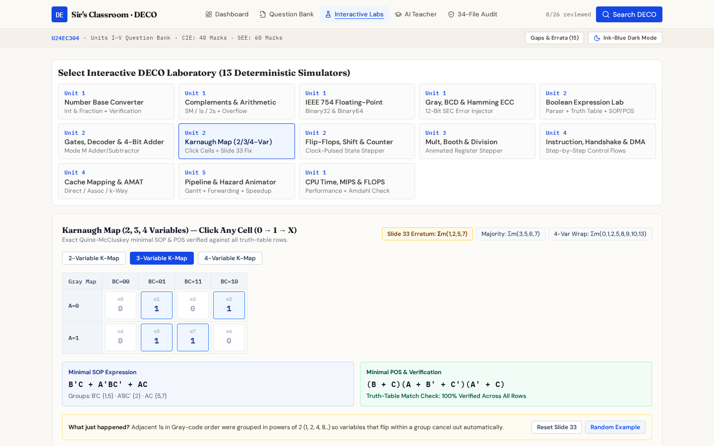

# Sir's Classroom · DECO (`U24EC304`)

**Complete Topic-Wise Question Bank, Exam Answer System & Interactive Laboratory for Digital Electronics and Computer Organization (Units I–V)**

[](#curriculum-coverage)
[](#curriculum-coverage)
[](#4-complete-34-file-source-audit-and-syllabus-coverage-matrix)
[](#tech-stack)
[](#tech-stack)
[](#tech-stack)
[](#tech-stack)

---

## Overview

**Sir's Classroom · DECO** is a unified, beginner-first engineering study and exam-preparation platform built directly from **34 original academic source files** (lecture decks, question banks, assignments, surprise tests, quizzes, CSV survey responses, and reference diagrams) for **Digital Electronics & Computer Organization (`U24EC304`)**.

Instead of scattering definitions, derivations, and answer keys across dozens of PDFs, the workspace consolidates the entire syllabus into one auditable system:

| Metric | Verified Count | Scope |
| :--- | :---: | :--- |
| **Official Syllabus Units & Topics** | **5 Units · 26 Topics** | `100%` aligned against `Syllabus_DECO.pdf` |
| **Consolidated Question Bank** | **45 Questions** | Units I–V (`43`) + Outside-Syllabus audit items (`2`) |
| **Structured Exam Answers** | **45 4-Mark · 43 10-Mark** | Short & long exam answers with `17` professor-keyed items |
| **Interactive Simulators** | **13 Deterministic Labs** | Two-method verified calculations & step-by-step tracing |
| **Source File Traceability** | **34 / 34 Files Preserved** | Core DECO (`26`), Partial Overlap (`4`), Outside Scope (`4`) |
| **Verified Source Audits** | **9 Errata · 6 Gaps** | Slide/answer-key conflicts flagged inline beside questions |

---

## Visual Showcase

### 1. Syllabus & Exam Preparation Dashboard
Tracks topic review progress (`0/26`), answer coverage (`45 4M · 43 10M`), and organizes Units I–V by Course Outcomes (`CO1–CO5`) with direct shortcuts to topic Q&As and labs.


### 2. Topic-Wise Question Bank (4-Mark & 10-Mark Exam Answers)
Filters questions by Unit, Topic (`DECO-U1-T1` through `DECO-U5-T4`), provenance, category, or answer availability (`Both 4M & 10M`, `4-Mark Short Only`, `10-Mark Long Only`). Each topic provides a **Concept Brief & SVG Exam Diagram**, errata/conflict warnings (such as the Unit II Slide 33 K-Map fix), copyable 4M/10M study answers, and print-ready study sheets.


### 3. Interactive DECO Laboratories (13 Deterministic Simulators)
Hands-on calculators and step-by-step visualizers across Units I–V—including Base Conversion (Integer & Fractional), Signed Complements, IEEE 754 Floating-Point, Gray/BCD/Hamming `(12,8)` SEC, Boolean Parser, Combinational Adders, **Quine–McCluskey 2/3/4-Var K-Map Solver**, Sequential Flip-Flops/Counters, Booth & Restoring/Non-Restoring Division, I/O Handshake & DMA, Cache Mapping & AMAT, 5-Stage Pipeline Hazards, and CPU Performance / Amdahl's Law.



### 4. Complete 34-File Source Audit and Syllabus Coverage Matrix
Proves `26/26` official syllabus coverage while preserving every original file, cross-referencing **9 source errata**, **6 missing-content gaps**, and **31 anonymous student CSV survey responses**.


---

## Key Features

- **Structured 4-Mark & 10-Mark Exam Answers**: Every mapped question includes formatted short (4M) and long (10M) exam responses with definitions, keywords to underline, diagrams to draw, and dual-method numerical verification checks.
- **Topic Concept Briefs & Embedded SVG Exam Diagrams**: Clean schematic diagrams (`ExamDiagrams.tsx`) covering Von Neumann functional units, logic gates, SOP/POS, K-maps, adders/MUXes, flip-flops/counters, Booth & division flowcharts, RTL timing, DMA/cache mapping, and 5-stage RISC pipelining.
- **Errata & Conflict Detection**: Preserves original professor slides while explicitly flagging arithmetic/logic discrepancies inline (e.g., `DECO_U2_01Aug25.pdf` Slide 33 non-adjacent K-map grouping and Slide 34 missing minterm, plus `DECO_Assignment2_Answers.pdf` DMA/bus-request clarifications).
- **13 Verified Pure-Logic Simulators**: Calculation engines in `src/utils/calculators.ts` run deterministically in-browser and are backed by unit tests in `src/utils/calculators.test.ts`.
- **Fast Navigation & Study Tools**:
  - Global command search (`Ctrl+K` / `Cmd+K`) across all 26 topics, 45 questions, and 34 source files.
  - One-click clipboard copy for 4M/10M answers and **Print Study Sheet** mode.
  - High-contrast **Ink-Blue Dark Mode** toggle with persistent local review tracking.
- **Optional Server-Side AI Teacher (`GEMINI_API_KEY`)**: Express route (`/api/ai-teacher`) in `server.ts` grounded in `U24EC304` syllabus rules for guided student Q&A without exposing API keys in client code.

---

## Curriculum Coverage

Course Code: **`U24EC304` — Digital Electronics & Computer Organization** (3 Credits · `L: 3 · T: 0 · D: 0 · P: 0` · CIE `40` + SEE `60` Marks)

| Unit | Title | Course Outcomes | Topics | Questions |
| :--- | :--- | :---: | :---: | :---: |
| **Unit I** | Basic Structure of Computers & Data Representation | `CO1 · CO4` | 6 | 10 |
| **Unit II** | Switching Theory & Digital Logic Circuits | `CO1 · CO2 · CO3` | 7 | 10 |
| **Unit III** | Computer Arithmetic, Instructions, RTL & Microprogrammed Control | `CO4` | 5 | 9 |
| **Unit IV** | Input/Output & Memory Organization | `CO4 · CO5` | 4 | 8 |
| **Unit V** | Pipelining & Reduced Instruction Set Computer (RISC / CISC) | `CO4 · CO5` | 4 | 6 |
| **Audit Scope** | Outside-Syllabus Reference Items (e.g., 8086 PIN / QBF-BDD) | — | — | 2 |
| **Total** | **Official `U24EC304` Curriculum + Audit** | **CO1–CO5** | **26** | **45** |

---

## Tech Stack

- **Frontend**: React `19`, TypeScript `7`, Vite `8`, Tailwind CSS `v4` (`@tailwindcss/vite`), `lucide-react`, `motion`
- **Backend**: Node.js + Express `4` (`server.ts` serving Vite middleware in dev and `dist/` in production)
- **AI Integration (Optional)**: `@google/genai` server-side endpoint (`POST /api/ai-teacher` + `GET /api/health`)
- **Testing & Quality**: `tsc --noEmit` (`npm run lint`) and `node:test` via `tsx` (`src/utils/calculators.test.ts`)

---

## Project Structure

```text
├── server.ts                        # Express + Vite dev/prod server & /api/ai-teacher proxy
├── index.html                       # App entry point & typography setup
├── metadata.json                    # Applet metadata & capability declarations
├── .env.example                     # Environment variable template (GEMINI_API_KEY, APP_URL)
├── docs/
│   └── screenshots/                 # Showcase screenshots used in this README
├── public/
│   └── assets/aistudio/             # Preserved 34 original source PDFs, CSV, and images
└── src/
    ├── App.tsx                      # Root workspace state, routing, search & dark mode
    ├── types/academic.ts            # TypeScript models for units, topics, Q&As, and audit records
    ├── data/
    │   ├── knowledgeBase.ts         # 5 Units & 26 official syllabus topics with concept briefs
    │   ├── questionsUnit1.ts ... 5  # Unit-by-unit consolidated 4M & 10M exam questions
    │   ├── questionsBank.ts         # Unified 45-question export
    │   └── filesInventory.ts        # 34-file audit, errata register, gap register & CSV summary
    ├── utils/
    │   ├── calculators.ts           # Deterministic simulators & Quine–McCluskey solver
    │   └── calculators.test.ts      # node:test verification suite for mathematical engines
    └── components/
        ├── HeaderNav.tsx            # Top navigation, progress meter & dark-mode toggle
        ├── QuestionBankView.tsx     # Topic sidebar, 4M/10M filters, errata alerts & print view
        ├── InteractiveLabs.tsx      # 13 interactive DECO laboratories
        ├── SourceAuditView.tsx      # 34-file registry, gap/errata tabs & syllabus matrix
        ├── ExamDiagrams.tsx         # Topic-aligned SVG schematics
        ├── AITeacherView.tsx        # Guided U24EC304 tutor interface
        ├── GlobalSearchModal.tsx    # Ctrl+K / Cmd+K quick navigation modal
        └── FilePreviewModal.tsx     # In-app modal for inspecting original source files
```

---

## Getting Started

### 1. Prerequisites
- **Node.js** `20+` (tested on Node `v22`)
- **npm**

### 2. Installation & Environment
```bash
npm install
```

Create a `.env` file from `.env.example` if you want to enable the optional **AI Teacher** tab:
```bash
cp .env.example .env
```
Set `GEMINI_API_KEY` inside `.env`. All syllabus browsing, 4M/10M question banks, source audits, and all 13 deterministic simulators work completely offline without an API key.

### 3. Run in Development
```bash
npm run dev
```
The Express + Vite server listens on `http://localhost:3000`.

### 4. Production Build & Start
```bash
npm run build
npm run start
```

---

## Verification & Testing

Run TypeScript static type-checking, calculator unit tests, and production bundle verification:

```bash
# 1. TypeScript check
npm run lint

# 2. Pure-logic simulator unit tests (11/11 checks)
npx tsx --test src/utils/calculators.test.ts

# 3. Production Vite build
npm run build
```
